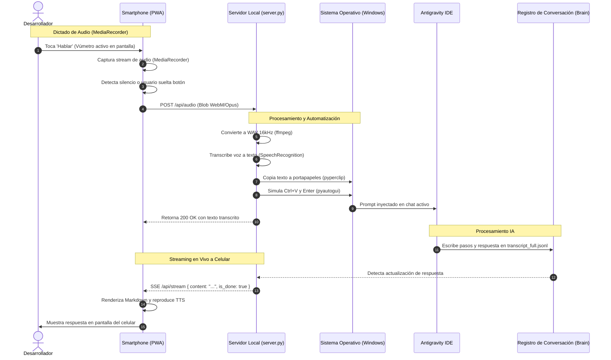

# Mapa Conceptual y Arquitectura - Antispeech

## 1. Título y Propósito
**Antispeech** es una solución de puente de hardware y software que transforma un celular móvil (Android o iOS) en un micrófono inalámbrico interactivo de baja latencia para el entorno de desarrollo **Google Antigravity IDE**.

Permite al desarrollador dictar prompts en lenguaje natural usando un motor híbrido de voz (MediaRecorder de audio directo procesado con `ffmpeg` + `SpeechRecognition` en el servidor, o Web Speech API en el navegador), inyectar automáticamente el texto en el chat activo del IDE mediante portapapeles (`pyautogui` + `pyperclip`), y **visualizar en tiempo real en la pantalla del celular la respuesta y pasos de razonamiento generados por la IA**.

---

## 2. Arquitectura General y Tecnologías

### Stack Técnico
* **Servidor Backend Local:** Python 3.10+ (`http.server`, `threading`, `ssl`, `zoneinfo`).
* **Motor STT en Servidor:** `SpeechRecognition` + `ffmpeg` (conversión instantánea de WebM/OGG/MP4 a WAV 16kHz mono).
* **Automatización de Teclado:** `pyautogui` + `pyperclip` (inyección rápida mediante portapapeles para soportar 100% de caracteres en español, acentos, `ñ`, signos `¿?`, emojis y saltos de línea).
* **Seguridad y Criptografía:** `cryptography` (generación dinámica de certificados SSL autofirmados con extensiones SAN para la IP local).
* **Frontend Mobile / PWA:** Progressive Web App de archivo único (`pwa/index.html`), compatible con Service Worker (`sw.js`) y `manifest.json`.
* **Motor de Voz Dual:**
  1. *Modo Servidor (MediaRecorder - Por defecto):* Captura el audio en bruto con `getUserMedia()`, muestra un vúmetro en tiempo real, y envía el archivo al endpoint `POST /api/audio`. Resuelve los bloqueos de Google Speech en Android Chrome.
  2. *Modo Web Speech API:* Reconocimiento en el navegador con `continuous = false` para evitar congelamientos en Android.
* **Visualizador de Respuestas:** Integración con el motor de transcripciones de Antigravity (`~/.gemini/antigravity/brain/<conv_id>/.system_generated/logs/transcript_full.jsonl`) con transmisión en vivo vía Server-Sent Events (SSE) y polling fallback.
* **Formateo:** `marked.js` para renderizar código y Markdown en la pantalla del celular.

### Diagrama de Flujo y Comunicación (Mermaid)

---

## 3. Características Globales y Decisiones UX/UI

1. **Vúmetro y Diagnóstico Visual en el Teléfono:**
   * La PWA dibuja un ecualizador en vivo usando `AnalyserNode` de la Web Audio API. El usuario ve las barras moverse mientras habla, garantizando que el micrófono físico está capturando sonido.
   * Barra de diagnóstico superior que informa el estado exacto: `"Grabando audio..."`, `"Transfiriendo a PC..."`, `"✓ Transcrito e Inyectado"`.
2. **Contexto Seguro HTTPS Obligatorio en LAN:**
   * `server.py` genera automáticamente certificados SSL autofirmados (`cert.pem`, `key.pem`) asignados a la IP local para que los navegadores móviles permitan el acceso al micrófono.
3. **Inyección Inmune a Distribución de Teclado:**
   * Usa `pyperclip.copy()` seguido de `Ctrl + V` y `Enter`. La inserción es instantánea y respeta saltos de línea y emojis.
4. **Pantalla Siempre Activa (Wake Lock API):**
   * Mantiene el smartphone activo durante la sesión de programación.
5. **Detección Automática de Silencio:**
   * Al hacer una pausa de 1.4 segundos en el habla, el audio se corta y se despacha automáticamente a la PC.

---

## 4. Detalle de Módulos y Lógica de Negocio

### 4.1. Módulo Servidor (`server.py`)
* `_transcribe_audio_bytes()`:
  * Recibe el audio binario de `POST /api/audio`.
  * Invoca `ffmpeg` para normalizar la tasa de muestreo a 16000 Hz, canal mono PCM.
  * Ejecuta `recognizer.recognize_google(audio, language="es-ES")`.
* `_inject_prompt_to_active_window()`: Ejecuta la inyección en un hilo separado tipo `daemon` para evitar bloquear la respuesta HTTP 200 hacia el celular.
* `get_latest_conversation_response()`: Lee `transcript_full.jsonl` del directorio de conversación más reciente de Antigravity.
* **Zona Horaria:** Todos los logs y auditorías se calculan y presentan explícitamente en `America/Caracas` (VET, UTC-4).

### 4.2. Módulo Cliente PWA (`pwa/index.html`)
* **Motor MediaRecorder:** Captura paquetes de audio periódicos (cada 250ms).
* **Audio Visualizer:** Dibuja sobre `<canvas>` con gradiente violeta/azul y calcula el volumen promedio para el disparo automático por silencio.
* **Motor TTS:** Lectura en voz alta opcional en el altavoz del celular.
