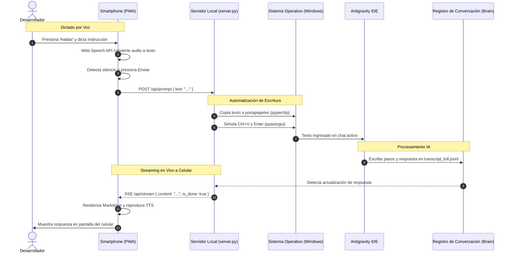

# Mapa Conceptual y Arquitectura - Antispeech

## 1. Título y Propósito
**Antispeech** es una solución de puente de hardware y software que transforma un celular móvil (Android o iOS) en un micrófono inalámbrico interactivo de baja latencia para el entorno de desarrollo **Google Antigravity IDE**.

Permite al desarrollador dictar prompts en lenguaje natural usando la Web Speech API del navegador de su smartphone, inyectar automáticamente el texto en el chat activo del IDE en la computadora de escritorio mediante automatización de teclado (`pyautogui` + `pyperclip`), y **visualizar en tiempo real en la pantalla del celular la respuesta y pasos de razonamiento generados por la IA**.

---

## 2. Arquitectura General y Tecnologías

### Stack Técnico
* **Servidor Backend Local:** Python 3.10+ (`http.server`, `threading`, `ssl`, `zoneinfo`).
* **Automatización de Teclado:** `pyautogui` + `pyperclip` (inyección rápida mediante portapapeles para soportar 100% de caracteres en español, acentos, `ñ`, signos `¿?`, emojis y saltos de línea).
* **Seguridad y Criptografía:** `cryptography` (generación dinámica de certificados SSL autofirmados con extensiones SAN para la IP local).
* **Frontend Mobile / PWA:** Progressive Web App de archivo único (`pwa/index.html`), compatible con Service Worker (`sw.js`) y `manifest.json`.
* **Motor de Voz:** Web Speech API (`SpeechRecognition` / `webkitSpeechRecognition`) con retroalimentación acústica por Web Audio API (`AudioContext`).
* **Visualizador de Respuestas:** Integración con el motor de transcripciones de Antigravity (`~/.gemini/antigravity/brain/<conv_id>/.system_generated/logs/transcript_full.jsonl`) con transmisión en vivo vía Server-Sent Events (SSE) y polling fallback.
* **Formateo:** `marked.js` para renderizar código y Markdown en la pantalla del celular.

### Diagrama de Flujo y Comunicación (Mermaid)

---

## 3. Características Globales y Decisiones UX/UI

1. **Contexto Seguro HTTPS Obligatorio en LAN:**
   * La Web Speech API y el acceso al micrófono en navegadores móviles (Chrome Android, Safari iOS) están restringidos por política de seguridad a contextos seguros (`HTTPS` o `localhost`).
   * `server.py` genera automáticamente en el arranque certificados SSL autofirmados (`cert.pem`, `key.pem`) asignados a la IP de red local del usuario.
2. **Vinculación Cero-Fricción con Código QR:**
   * El script detecta la IP privada de la máquina (`192.168.x.x`) y genera un código QR ASCII directamente en la consola de Windows para que el usuario simplemente apunte la cámara del celular.
3. **Inyección Inmune a Distribución de Teclado:**
   * En lugar de emular tecla por tecla (`typewrite`) —que corrompe caracteres especiales como `á, é, í, ó, ú, ñ, ¿, ¡`—, el sistema usa `pyperclip.copy()` seguido de `Ctrl + V` y `Enter`. La inserción es instantánea y respeta saltos de línea y emojis.
4. **Pantalla Siempre Activa (Wake Lock API):**
   * La PWA solicita un bloqueo de suspensión de pantalla (`navigator.wakeLock`) para evitar que el teléfono se apague mientras se programa en pareja.
5. **Detección Automática de Silencio (Auto-envío):**
   * Temporizador configurable (1.3 segundos por defecto). Al terminar de hablar, el prompt se dispara solo al IDE sin necesidad de tocar la pantalla.

---

## 4. Detalle de Módulos y Lógica de Negocio

### 4.1. Módulo Servidor (`server.py`)
* `get_local_ip()`: Determina la interfaz LAN activa abriendo un socket UDP contra un DNS público (`8.8.8.8:80`) sin enviar tráfico real.
* `generate_self_signed_cert()`: Utiliza `cryptography.x509` para emitir un certificado RSA 2048-bit válido por 365 días con nombres alternativos de sujeto (SAN) para `localhost` y la IP local.
* `get_latest_conversation_response()`:
  * Examina `~/.gemini/antigravity/brain`.
  * Filtra la carpeta de conversación con el `mtime` más reciente.
  * Lee hacia atrás las líneas JSONL buscando entradas `MODEL` con `type: PLANNER_RESPONSE`.
  * Determina si el modelo está en ejecución de herramientas (`status: generating`) o si emitió su respuesta final al usuario (`status: ready, is_done: true`).
* `_inject_prompt_to_active_window()`: Ejecuta la inyección en un hilo separado tipo `daemon` para evitar bloquear la respuesta HTTP 200 hacia el celular.
* **Zona Horaria:** Todos los logs y auditorías se calculan y presentan explícitamente en `America/Caracas` (VET, UTC-4).

### 4.2. Módulo Cliente PWA (`pwa/index.html`)
* **Audio Feedback:** Dos frecuencias sinusoidales en `AudioContext`:
  * `880 Hz`: Beep agudo de confirmación de inicio de escucha.
  * `440 Hz`: Beep medio de parada.
  * `1200 Hz`: Acorde agudo de envío exitoso.
* **Motor TTS (Text-to-Speech):** La PWA incluye un botón "Escuchar" y un toggle de lectura automática para que el teléfono lea en voz alta la respuesta de la IA a través del altavoz.
* **Manejo de Errores Móviles:** Si el reconocimiento se interrumpe por el motor de Android, el evento `onend` reengancha automáticamente la sesión de escucha si `state.isRecording` sigue activo.
