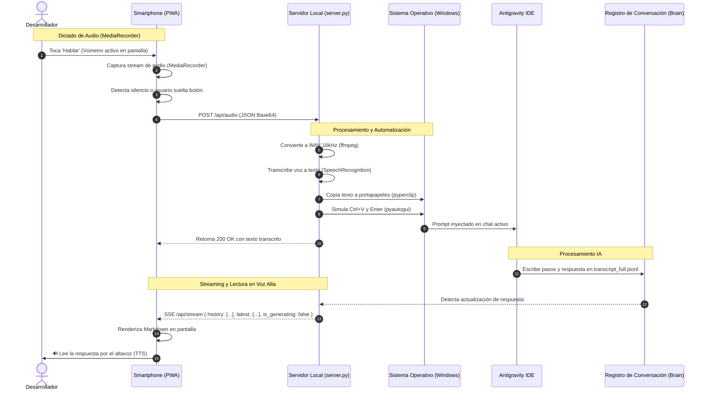

# Mapa Conceptual y Arquitectura - Antispeech

## 1. Título y Propósito
**Antispeech** es una solución de puente de hardware y software que transforma un celular móvil (Android o iOS) en un micrófono inalámbrico interactivo de baja latencia para el entorno de desarrollo **Google Antigravity IDE**.

Permite al desarrollador dictar prompts en lenguaje natural usando un motor híbrido de voz (MediaRecorder de audio directo procesado con `ffmpeg` + `SpeechRecognition` en el servidor, o Web Speech API en el navegador), inyectar automáticamente el texto en el chat activo del IDE mediante portapapeles (`pyautogui` + `pyperclip`), **visualizar en tiempo real el historial completo del chat y las respuestas en la pantalla del celular**, y **escuchar las respuestas de la IA leídas en voz alta automáticamente por el altavoz del celular (Text-to-Speech)**.

---

## 2. Arquitectura General y Tecnologías

### Stack Técnico
* **Servidor Backend Local:** Python 3.10+ (`ThreadingHTTPServer` concurrente, `ssl`, `zoneinfo`).
* **Motor STT en Servidor:** `SpeechRecognition` + `ffmpeg` (conversión instantánea de WebM/OGG/MP4 a WAV 16kHz mono).
* **Automatización de Teclado:** `pyautogui` + `pyperclip` (inyección rápida mediante portapapeles para soportar 100% de caracteres en español, acentos, `ñ`, signos `¿?`, emojis y saltos de línea).
* **Seguridad y Criptografía:** `cryptography` (generación dinámica de certificados SSL autofirmados con extensiones SAN para la IP local).
* **Frontend Mobile / PWA:** Progressive Web App de archivo único (`pwa/index.html`), compatible con Service Worker (`sw.js`) y `manifest.json`.
* **Historial Completo & Visor de Respuestas:** Integración con el motor de transcripciones de Antigravity (`~/.gemini/antigravity/brain/<conv_id>/.system_generated/logs/transcript_full.jsonl`) con transmisión en vivo vía Server-Sent Events (SSE) y endpoint `/api/history`.
* **Motor TTS Automático:** Web Speech Synthesis (`SpeechSynthesisUtterance`) activado por defecto con desbloqueo acústico ante el primer gesto del usuario y filtro de markdown/bloques de código.
* **Formateo:** `marked.js` para renderizar código y Markdown en la pantalla del celular.

### Diagrama de Flujo y Comunicación (Mermaid)

---

## 3. Características Globales y Decisiones UX/UI

1. **Lectura por Voz Automática (Auto-TTS) Activada por Defecto:**
   * La PWA ahora sintetiza la voz de inmediato cuando la IA termina de generar su respuesta.
   * Filtra bloques de código largos y símbolos markdown para que el teléfono hable de forma natural y amigable.
   * Botón `⏹️` flotante para detener la lectura en cualquier momento.
2. **Carga Inmediata del Historial de Chat:**
   * Al abrir o recargar la página en el celular, `/api/history` entrega los últimos mensajes de la conversación, de modo que el celular nunca queda en blanco.
3. **Vúmetro y Diagnóstico Visual:**
   * Animación en tiempo real del nivel de audio sobre canvas con gradiente violeta/azul.
4. **Contexto Seguro HTTPS Obligatorio en LAN:**
   * Certificados SSL dinámicos emitidos por `cryptography` para cumplir con las políticas de micrófono de Chrome y Safari.
5. **Pantalla Siempre Activa (Wake Lock API):**
   * Previene la suspensión del teléfono durante la jornada de desarrollo.

---

## 4. Detalle de Módulos y Lógica de Negocio

### 4.1. Módulo Servidor (`server.py`)
* `get_conversation_data()`:
  * Extrae cronológicamente tanto los mensajes del usuario (`USER_INPUT`) como las respuestas del asistente (`PLANNER_RESPONSE`).
  * Distingue si la IA está trabajando (`is_generating: True`) o si la respuesta final está lista (`is_generating: False`).
* `_transcribe_audio_bytes()`: Transforma el audio recibido a WAV mono 16kHz y lo transcribe con Google Speech API.
* `_inject_prompt_to_active_window()`: Inyecta el texto con portapapeles y `Enter` en un hilo no bloqueante.
* **Zona Horaria:** Todos los logs y marcas de auditoría se calculan y presentan explícitamente en `America/Caracas` (VET, UTC-4).

### 4.2. Módulo Cliente PWA (`pwa/index.html`)
* **Gestión de Pasos y Evitación de Bucles:** Utiliza `state.renderedSteps` (Set) y `state.lastSpokenStep` para garantizar que un mensaje se renderice una sola vez y no se repita en bucle por el altavoz.
* **Desbloqueo de Audio en Dispositivos Móviles:** Para sortear las políticas de auto-reproducción de Android y iOS, emite una micro-expresión silenciosa ante el primer evento táctil en la pantalla.
