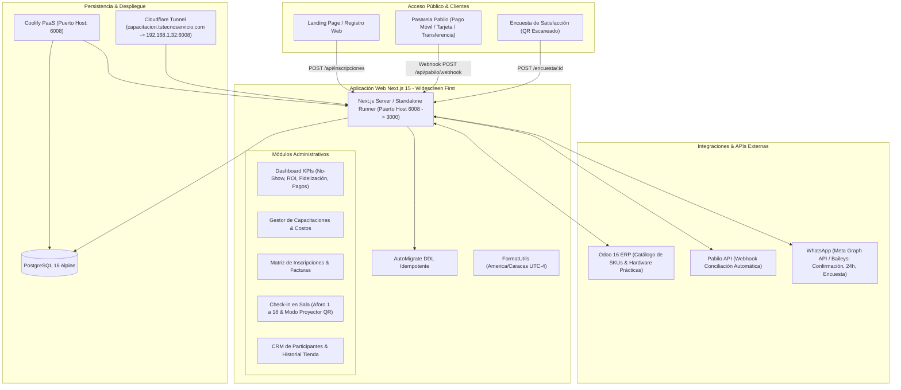

# Mapa Conceptual y Arquitectura del Sistema: Onprotec Capacitaciones

Este documento sirve como la **guía de supervivencia técnica y funcional** para la aplicación web de gestión, control de aforo, finanzas e integraciones de la **Sala de Capacitaciones de Onprotec C.A.**

---

## 1. Título y Propósito

* **Aplicación:** Onprotec Capacitaciones (Control de Aforo, CRM y Rentabilidad de Formación Técnica).
* **Propósito:** Centralizar el registro público de participantes, la validación automática de pagos (Pabilo), el control del aforo físico limitado de la sala (**aforo máximo estricto: 18 participantes + 1 instructor en tarima**), la gestión de lista de espera prioritaria, el cálculo de rentabilidad financiera (ROI), el mapa de conversión/fidelización de clientes frente a compras de hardware en tienda (Odoo ERP) y el check-in en tiempo real con encuestas de satisfacción generadas por código QR.

---

## 2. Arquitectura General y Tecnologías

### Stack Técnico:
* **Framework:** Next.js 15 (App Router) con TypeScript y modo `standalone` para Docker.
* **Base de Datos & ORM:** PostgreSQL 16 con Drizzle ORM (`drizzle-orm` + `pg`).
* **Auto-Migraciones:** Script `src/lib/autoMigrate.ts` idempotente (`CREATE TABLE IF NOT EXISTS`, `ALTER TABLE ... ADD COLUMN IF NOT EXISTS`).
* **Estilos & Diseño:** Tailwind CSS con paleta Onprotec Navy/Cyan/Blue y arquitectura Widescreen-First.
* **Zona Horaria:** `America/Caracas` (UTC-4) obligatoria vía `src/utils/formatUtils.ts`.
* **Despliegue:** Dockerfile multi-stage (Node 22-alpine), `docker-compose.yml`, Coolify y Cloudflare Tunnel.

---

## 3. Características Globales y Filosofía UX/UI

1. **Widescreen-First (Sin Scroll Vertical Innecesario):**
   * En pantallas de escritorio (1080p, 1440p, laptops), la información de primer nivel y métricas críticas se presentan en filas horizontales de 4 columnas o paneles paralelos tipo Split View.
   * Cintillo de navegación fijo (`sticky top-0 z-50`) con estado de integraciones (Odoo, Pabilo, Hora Venezuela).
   * Se reorganiza a flujo vertical amigable únicamente en dispositivos móviles o tablets (`max-width: 768px`).

2. **Horarios Locales Respetados (America/Caracas):**
   * Todas las fechas de eventos, aperturas de publicidad, confirmaciones 24h y timestamps de check-in se guardan en UTC en base de datos pero se renderizan forzosamente en `America/Caracas` (UTC-4) mediante `fmtLocalTime` y `fmtLocalDate`.

---

## 4. Detalle por Módulos y Lógica de Negocio

### A. Control de Aforo y Gestión de Cupos (Sala Onprotec)
* **Regla de Capacidad:** La sala física cuenta con una capacidad máxima estricta de **18 puestos para participantes** y **1 puesto para el instructor**.
* **Condición de Sobrecupo y Lista de Espera:**
  $$\text{Ocupación Activa} = \text{Inscritos} + \text{Confirmados} + \text{Asistió}$$
  * Si $\text{Ocupación Activa} < 18$: El participante ingresa con estado **`Inscrito`**.
  * Si $\text{Ocupación Activa} \ge 18$: La aplicación le asigna automáticamente el estado **`Lista de Espera`**. En la UI pública se notifica que los 18 cupos están cubiertos y que su puesto es prioritario ante cancelaciones.

### B. Funnel de Asistencia y Tasa de No-Show
* **Fórmula de Tasa de No-Show:**
  $$\text{Tasa No-Show (\%)} = \left(\frac{\text{No Asistió}}{\text{Confirmados}}\right) \times 100$$
* **Fórmula de Asistencia Efectiva:**
  $$\text{Asistencia Efectiva (\%)} = \left(\frac{\text{Asistió}}{\text{Confirmados}}\right) \times 100$$
* **Flujo Operativo:**
  1. Inscrito en landing web.
  2. Disparo de WhatsApp 24 horas antes solicitando confirmación.
  3. Cambio de estado a `Confirmado`.
  4. El día del evento en la puerta de la sala: Check-in presencial $\rightarrow$ Estado `Asistió`.
  5. Quien confirmó pero no asistió $\rightarrow$ Estado `No Asistió`.

### C. Retorno de Inversión (ROI Financiero)
* **Ingresos Brutos:** Sumatoria de las inscripciones con `isPaid = true` (en USD o contravalor en Bs).
* **Costos Totales:**
  $$\text{Costos Totales} = \text{Costos de Publicidad (Meta/Google Ads)} + \text{Costos Asociados (Refrigerios, Materiales, Logística)}$$
* **Utilidad Neta:**
  $$\text{Utilidad Neta} = \text{Ingresos Brutos} - \text{Costos Totales}$$
* **Porcentaje de ROI:**
  $$\text{ROI (\%)} = \left(\frac{\text{Utilidad Neta}}{\text{Costos Totales}}\right) \times 100$$

### D. Mapa de Fidelización y Cross-Selling de Hardware
* **Objetivo:** Medir la efectividad de las capacitaciones técnicas como gancho comercial para vender equipos de la tienda Onprotec.
* **Métricas:**
  * **Clientes Existentes:** Participantes con `hasStorePurchases = true`.
  * **Prospectos Vírgenes:** Participantes técnicos/instaladores que **no** han comprado en tienda.
  * **Recurrentes Sin Compra:** Porcentaje de alumnos que han asistido a más de 1 capacitación pero todavía no compran suministros físicos.

### E. Integraciones
1. **Odoo ERP:**
   * Conexión JSON-RPC con `product.template` para importar los SKUs de los equipos que se utilizan en los laboratorios prácticos (cámaras Hikvision, grabadores NVR, fusionadoras de fibra, biométricos).
2. **Pabilo Pay:**
   * Validación automática de pagos con webhook firmado mediante HMAC-SHA256 (`/api/pabilo/webhook`).
   * Al validarse la transacción en Pabilo, la inscripción pasa automáticamente a `isPaid = true` y estado `Confirmado`.
3. **WhatsApp Engine:**
   * Automatización de 3 plantillas críticas: Confirmación inmediata de registro, recordatorio 24h antes del evento con la ubicación de la sala Onprotec, y envío del link de encuesta post-evento.
4. **Códigos QR de Encuesta:**
   * Generación de código QR único por evento para evaluar al instructor, contenido e instalaciones de la sala (escala 1 a 5 y NPS 1 a 10).
   * Modo Kiosk / Proyector en el módulo de Check-in para proyectar el QR en pantalla gigante.

---

## 5. Instrucciones de Despliegue en Coolify & Cloudflare Tunnel
 
 1. **Creación en Coolify:**
    * Tipo: **Application from Git Repository** o **Docker Compose**.
    * Puerto expuesto / Mapeo de puertos: **`6008:3000`** (Host Port 6008 apuntando al contenedor 3000).
    * Dominio FQDN: **`https://capacitacion.tutecnoservicio.com`**.
    * Variables de entorno: Importar desde `.env.example`.
 2. **Base de Datos PostgreSQL:**
    * Utilizar el servicio `db` de `docker-compose.yml` o el servicio gestionado de PostgreSQL en Coolify.
 3. **Cloudflare Tunnel:**
    * Configurar ruta: `capacitacion.tutecnoservicio.com` $\rightarrow$ `http://192.168.1.32:6008`.

---

## 6. Ingesta de Formularios Históricos Reales & Catálogo Odoo

A partir del volcado real de Google Forms (hojas de cálculo `.xlsx`) y exportación de Odoo en `Formularios/`:
* **Capacitaciones Procesadas:** 38 eventos reales organizados por marcas aliadas (Hikvision, Dahua, TP-Link Omada, WatchGuard/SGSI, Ubiquiti UniFi, Marsriva, EZVIZ).
* **Participantes Únicos:** 630 integradores y técnicos normalizados y deduplicados por Cédula/RIF, correo electrónico y número de WhatsApp.
* **Inscripciones Históricas:** 1.283 registros cargados con aforo máximo de 18 cupos por sesión presencial y asignación a Lista de Espera a partir del cupo 19.
* **Encuestas de Satisfacción:** 256 evaluaciones post-evento con calificaciones del instructor, contenido, comodidad de sala Onprotec y sugerencias de certificación oficial (ej. HCSA Hikvision).
* **Regla de Negocio Crítica:** La única capacitación que generó costo de inscripción fue **"De Cero a UniFi: Redes Inalámbricas y Wi-Fi Profesional"** ($60 USD, métodos Binance USDT/Pago Móvil y enlaces a comprobantes en Google Drive); todas las demás capacitaciones fueron 100% gratuitas ($0 USD).
* **Campos Nuevos Auto-Migrados:**
  * En `participants`: `cargo`, `city`, `experience_level`, `referral_source`, `allows_contact`. `doc_number` hecho nullable para formularios que solo capturaron WhatsApp.
  * En `registrations`: `original_form_name`, `form_submitted_at`, `payment_notes`, `experience_level`.
  * En `surveys`: `participant_name`, `company`, `cargo`, `most_liked`, `suggestions`, `wants_future_certifications`, `has_active_projects`, `submitted_at`.
  * Sincronizados e implementados de manera idempotente mediante `src/lib/autoMigrate.ts` con protección `ALTER TABLE ... ADD COLUMN IF NOT EXISTS`.
